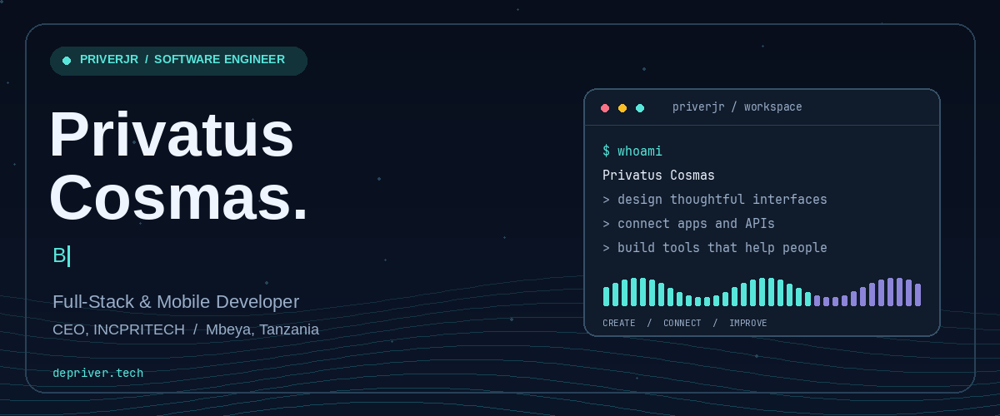

  

<h1 align="center">Hi, I'm Privatus Cosmas</h1>

<strong>Software Engineer · Full-Stack & Mobile Developer · CEO of INCPRITECH</strong>

I build practical digital products that help people and businesses get things done.

  
  
  

  <a href="#about-me">About</a> ·
  <a href="#what-i-build">Expertise</a> ·
  <a href="#selected-projects">Projects</a> ·
  <a href="#technology-toolkit">Technology</a> ·
  <a href="#lets-connect">Contact</a>

---

## About me

I'm a software engineer based in **Mbeya, Tanzania**, working across web applications, mobile experiences, AI tools and business systems. I enjoy taking an idea through its practical details: the interface people use, the services behind it, and the workflows that make it useful.

Alongside my software engineering work at **Rohi Company Limited**, I lead **INCPRITECH**, building digital products and technology solutions for businesses and individuals. My interests connect product development with automation, systems integration and technology that solves real community problems.

| At a glance | Details |
| --- | --- |
| **Name** | Privatus Cosmas |
| **GitHub** | [@priverjr](https://github.com/priverjr) |
| **Based in** | Mbeya, Tanzania |
| **Professional work** | Software Engineer and Digital Innovator, Rohi Company Limited |
| **Leadership** | Chief Executive Officer, INCPRITECH |
| **Education** | Diploma in Computer Science, Mbeya University of Science and Technology (MUST) |
| **Focus** | Web and mobile products, SaaS, AI integrations and business automation |
| **Writing & personal story** | [depriver.tech](https://depriver.tech) |

## What I build

- **Web applications:** responsive interfaces, dashboards, portals and interactive product experiences.
- **Mobile applications:** Flutter and Dart applications, with an interest in useful, accessible experiences across devices.
- **SaaS and business systems:** software that brings operations, information and everyday workflows into one place.
- **AI tools and integrations:** assistants, conversational interfaces, SDK integrations and applied machine learning.
- **Systems integration:** connecting applications and services so information can move between them reliably.
- **Data experiences:** dashboards, reports and tools that make business information easier to understand.

## Selected projects

A selection of my public repositories and product work. The repositories below show different stages of development; see each project's documentation for its current scope.

### incdai — AI interfaces and tooling

Public interfaces for INCPRITECH's sovereign, decentralized AI runtime, with conversational experiences in **English and Swahili**. The public repository includes JavaScript and Python SDKs, an embeddable website widget, protocol documentation and integration examples.

**Focus:** AI integration · Developer tooling · Interoperable APIs · Voice and chat

[Repository](https://github.com/priverjr/incdai) · [Website](https://incdai.incpritech.com) · [Documentation](https://incdai.incpritech.com/docs/)

### Percelio — Courier and logistics applications

A courier and logistics platform explored through a **Flutter mobile application** and a companion web repository. The mobile codebase organizes screens, models, services and reusable widgets around the delivery experience.

**Focus:** Mobile development · Logistics workflows · Application architecture

[Mobile repository](https://github.com/priverjr/percelio-app) · [Web repository](https://github.com/priverjr/percelio-web)

### depriver.tech — Personal website and writing

My personal storytelling website and blog, built with **Astro, GSAP and Lenis**. A place to share my journey, lessons and ideas, with an emphasis on typography, motion and a thoughtful reading experience.

**Focus:** Content-driven websites · Frontend development · Interaction design

[Repository](https://github.com/priverjr/depriver-tech) · [Visit website](https://depriver.tech)

### Privatus — Interactive developer portfolio

A portfolio built with **React and Vite**, featuring Three.js visuals, Framer Motion animations and reusable interface components.

**Focus:** React · Creative frontend development · Motion and 3D interfaces

[Repository](https://github.com/priverjr/Privatus)

<strong>More projects and experiments</strong>

| Project | Exploration |
| --- | --- |
| [Artificial Tongue](https://github.com/priverjr/Artificial-Tongue) | Using machine learning to model taste recognition |
| [Battery Management System](https://github.com/priverjr/Battery-Management-Ssystem) | Monitoring battery state of charge and state of health |
| [Human Disease Prediction](https://github.com/priverjr/Human-Disease-prediction-using-ML-AI) | A group learning project exploring symptom-based prediction |
| [Online Book Shop](https://github.com/priverjr/Online_Book_Shop) | Combining a React frontend with a Django backend |
| [Python Scripts](https://github.com/priverjr/Python-Scripts) | Scripts for everyday programming tasks |

These projects reflect my learning and experimentation alongside product development.

## Building with INCPRITECH

Through INCPRITECH, I work on software that supports everyday business and service workflows. Product areas include:

| Product | Area of focus |
| --- | --- |
| **Uzaplus** | Business management and operational workflows |
| **Pleavo** | Event planning and management |
| **Restfo** | Delivery and everyday services, including cleaning, laundry and food delivery |
| **Viora** | AI assistance and business operations |
| **incdai** | Conversational AI, developer interfaces and user-controlled deployment options |

Explore the company at **[incpritech.com](https://incpritech.com)**. For source code and technical documentation, see the public repositories linked above.

## Technology toolkit

Technologies I use across product work, public projects and experimentation:

| Area | Technologies |
| --- | --- |
| **Mobile** | Flutter · Dart · Kotlin |
| **Web & interfaces** | React · TypeScript · JavaScript · Astro · HTML · CSS |
| **Backend & APIs** | Python · Django · Node.js |
| **AI & machine learning** | TensorFlow · scikit-learn · Jupyter notebooks |
| **Motion & creative web** | GSAP · Framer Motion · Three.js |
| **Programming foundations** | C++ · Java · Object-oriented programming |
| **Development workflow** | Git · GitHub · API integration · Technical documentation |

## How I approach engineering

1. **Understand the problem.** Start with the people, constraints and workflow the product needs to serve.
2. **Make the experience clear.** Design interfaces and flows that are easy to learn and practical to use.
3. **Keep the structure understandable.** Separate responsibilities and make the code easier to maintain.
4. **Connect the full system.** Think through how the interface, APIs and data work together.
5. **Learn through iteration.** Use feedback, testing and real use to guide the next improvement.

I'm especially interested in tools that work well in local contexts, support **Kiswahili**, and make useful technology more accessible.

## Beyond the code

I also enjoy **photography, video and content creation**, alongside piano, music, bike rides, calisthenics, nature and gaming. Creativity and curiosity shape both my technical work and the stories I share.

[Read my story →](https://depriver.tech/story/)

## Let's connect

Have a product idea, a technical challenge or an opportunity to collaborate? Send me a short introduction and tell me what you're building.

| Channel | Link |
| --- | --- |
| **Email** | [privercosmas@gmail.com](mailto:privercosmas@gmail.com) |
| **Portfolio & blog** | [depriver.tech](https://depriver.tech) |
| **GitHub** | [github.com/priverjr](https://github.com/priverjr) |
| **INCPRITECH** | [incpritech.com](https://incpritech.com) |

---

<strong>Built with curiosity. Focused on useful software. Made in Tanzania.</strong>

<!-- The animated banner is stored in this repository. Regenerate with scripts/generate_banner.py; see scripts/README.md. -->
